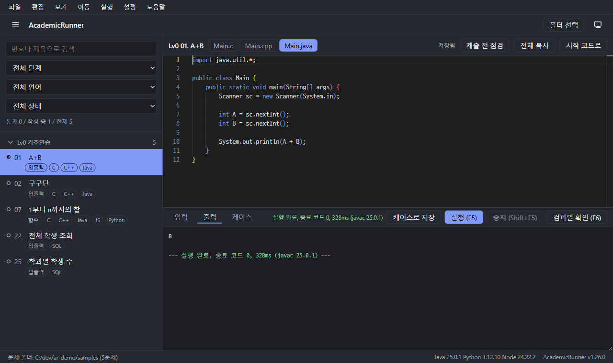
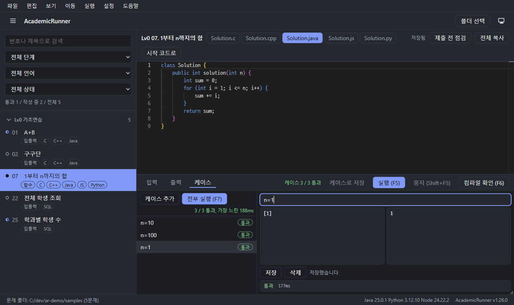
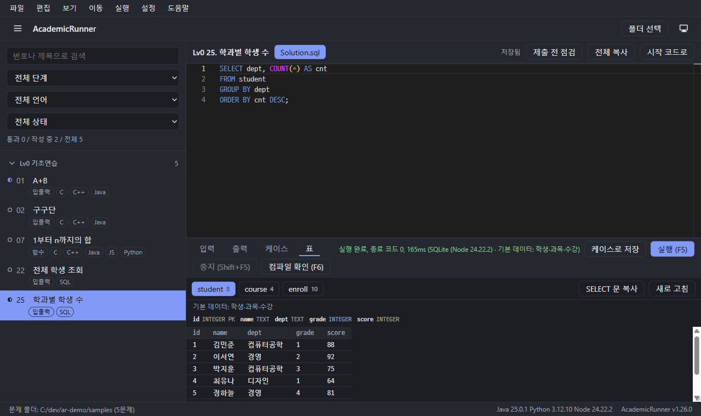

# 풀이터

학원 과제 풀이 파일(Java·Python·JavaScript)을 한 화면에서 열어 고치고, 클릭이나 단축키 한 번으로 실행·시험하는 개인용 Windows 앱입니다.

- 상태: v1.27.0 (옛 이름 AcademicRunner) (샘플 문제 포함) (SQL 표 보기 탭) (SQL 자동완성 여러 단어 문법: ORDER BY 등) (SQL 기본 데이터 자동 적용·편집) (문제 목록 단계 접기·언어 필터) (C/C++ 실행(gcc 필요)·SQL 실행(내장 SQLite), C/C++/SQL 단축 입력과 예약어 제안, 실시간 오류 표시 확장, 폰 접속, 환경 설정, 진행 현황, 문제 목록, 편집·자동 저장, 단축 입력(sout 등), 점 찍으면 메서드 자동 완성, 콘솔처럼 실시간 입력, Java·Python·JS 실행, 시험 케이스, 함수 문제 시험, 단축키). 단축키는 [docs/features/shortcuts.md](docs/features/shortcuts.md), 메뉴바와 단축키 바꾸기는 [docs/features/menubar-keymap.md](docs/features/menubar-keymap.md), 제출 전 점검은 [docs/features/submit-check.md](docs/features/submit-check.md), 진행 현황은 [docs/features/progress.md](docs/features/progress.md), 환경 설정은 [docs/features/settings.md](docs/features/settings.md), 폰 접속은 [docs/features/mobile-access.md](docs/features/mobile-access.md)
- 계획서: [docs/plans/00-master-plan.md](docs/plans/00-master-plan.md)
- 문제 풀이 보관 폴더: 기본 `C:\dev\AcademicTest`, 그 폴더가 없으면 저장소의 [samples](samples/README.md) (앱의 "폴더 선택"으로 변경)

## 화면

입출력 문제는 입력 탭에 값을 적고 실행하면 출력 탭에 결과가 나옵니다.



함수만 있는 문제는 케이스 탭에서 인수와 기대 반환값을 만들어 "전부 실행"으로 한 번에 시험합니다.



SQL 문제는 기본 표(student 등)가 자동으로 들어가고, "표" 탭에서 표의 열과 내용을 볼 수 있습니다.



(화면은 `samples` 폴더의 문제로 찍었습니다.)
## 실행

```bash
npm install
npm start
```

처음 써 보기: 저장소를 받고 위 두 줄을 실행하면 `samples` 의 문제 5개(입출력·함수·SQL)가 목록에 나옵니다. 필요한 것: Node.js 22.5 이상(SQL 실행에 내장 SQLite 사용), 언어별로 쓸 도구(Java 는 JDK, C/C++ 는 gcc, Python)는 있는 것만 실행됩니다.

테스트: `npm test`(도구가 없으면 그 언어 시험은 건너뜀), exe 만들기: `npm run dist:win` (결과는 `release-packager` 폴더)

앱 시험은 1차 확인용입니다. 사이트의 숨은 테스트는 알 수 없으므로 사이트 채점을 대신하지 않습니다.
